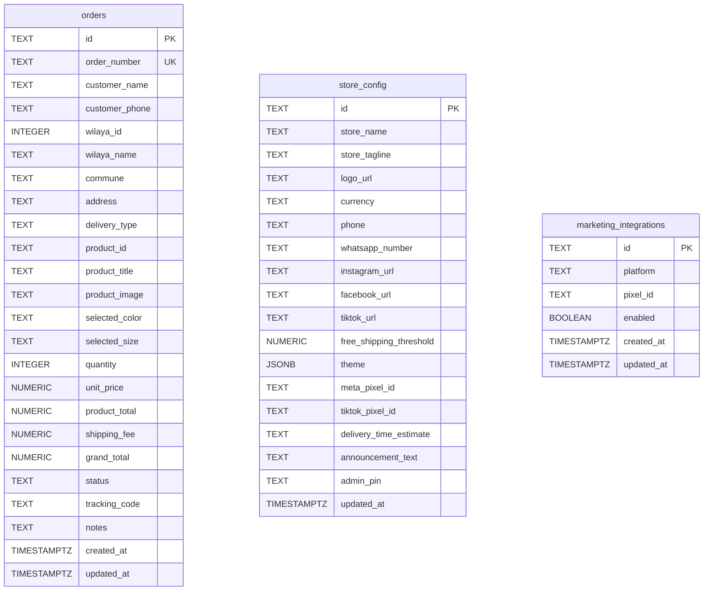
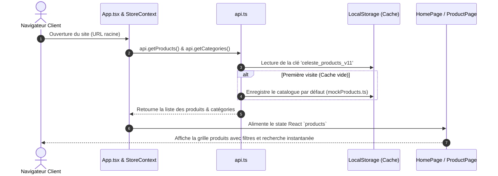
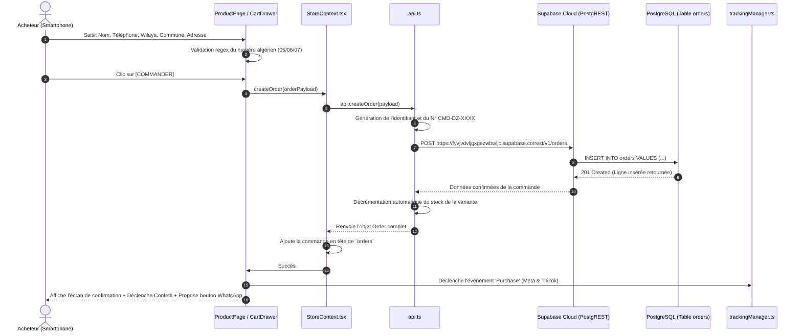
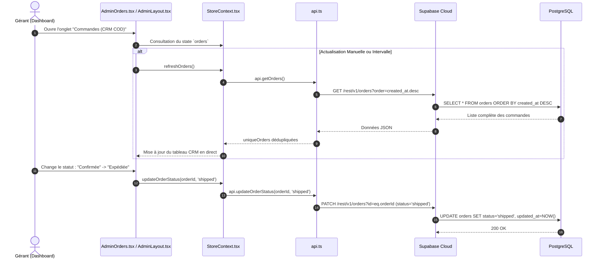
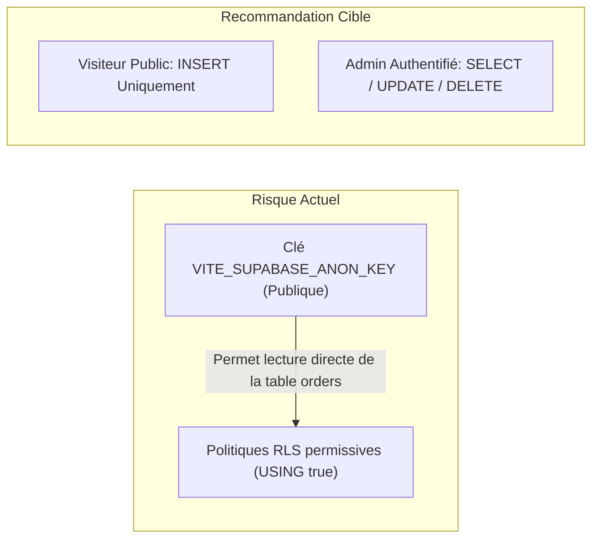

# AUDIT TECHNIQUE COMPLET & ARCHITECTURE DU SYSTÈME — MAISON CÉLESTE

> **Auteur :** Architecte Logiciel Senior (Full Stack, DevOps & Cybersécurité)  
> **Projet :** Maison Céleste (Haute Joaillerie & Couture • E-Commerce Cash on Delivery Algérie)  
> **Dépôt :** [mouhcenkeffous813/maison-celeste](https://github.com/mouhcenkeffous813/maison-celeste)  
> **Production :** [maison-celeste.vercel.app](https://maison-celeste.vercel.app)  
> **Base de Données Cloud :** Supabase PostgreSQL  
> **Date du Rapport :** 12 Novembre 2026  

---

## SOMMAIRE

1. [PARTIE 1 — Analyse du Projet & Arborescence Réelle](#partie-1--analyse-du-projet--arborescence-réelle)
2. [PARTIE 2 — Frontend (Interface Utilisateur & Expérience Client)](#partie-2--frontend-interface-utilisateur--expérience-client)
3. [PARTIE 3 — Backend (Logique Serveur & Architecture BaaS)](#partie-3--backend-logique-serveur--architecture-baas)
4. [PARTIE 4 — Base de Données (PostgreSQL & Supabase Cloud)](#partie-4--base-de-données-postgresql--supabase-cloud)
5. [PARTIE 5 — Communication entre Frontend, Backend et Database](#partie-5--communication-entre-frontend-backend-et-database)
6. [PARTIE 6 — Hébergement, CI/CD et Déploiement](#partie-6--hébergement-cicd-et-déploiement)
7. [PARTIE 7 — Audit de Sécurité & Recommandations](#partie-7--audit-de-sécurité--recommandations)
8. [PARTIE 8 — Schéma Global de l'Architecture (Mermaid)](#partie-8--schéma-global-de-larchitecture-mermaid)
9. [PARTIE 9 — Glossaire Technique Détaillé](#partie-9--glossaire-technique-détaillé)
10. [PARTIE 10 — Parcours d'Apprentissage & Guide de Maintenance](#partie-10--parcours-dapprentissage--guide-de-maintenance)

---

# PARTIE 1 — ANALYSE DU PROJET & ARBORESCENCE RÉELLE

### 1.1 Modèle Architectural Global
Le projet **Maison Céleste** est une **Single Page Application (SPA)** moderne construite avec **React 18** et **TypeScript**, packagée et optimisée via **Vite 5**. Elle repose sur le patron d'architecture **BaaS (Backend as a Service)** : il n'y a pas de serveur applicatif traditionnel intermédiaire (pas de serveur Express ou Django auto-hébergé). Le frontend communique directement avec **Supabase Cloud** (moteur PostgreSQL managé) via des requêtes HTTPS REST et des WebSockets temps réel.

### 1.2 Arborescence Complète du Projet

```text
e-commerce/
├── .github/
│   └── workflows/
│       └── ci.yml                     # Pipeline d'Intégration Continue (GitHub Actions)
├── docs/                              # Dossier de documentation technique et fonctionnelle
│   ├── 01-PRESENTATION.md             # Présentation métier du projet
│   ├── 02-ARCHITECTURE.md             # Diagrammes et flux initiaux
│   ├── 08-BASE-DE-DONNEES.md          # Spécifications de la base de données
│   └── ...                            # Guides d'installation, sécurité, maintenance
├── public/                            # Fichiers statiques servis directement à la racine
│   ├── images/
│   │   └── products/                  # Photos haute définition des produits (bijoux, robes, caftans)
│   ├── logo-icon.svg                  # Icône logo SVG
│   └── orlea-logo.svg                 # Logo vectoriel Maison Céleste
├── src/                               # Code source TypeScript / React
│   ├── components/
│   │   ├── admin/                     # Tableau de bord d'administration (Back-Office)
│   │   │   ├── AdminLayout.tsx        # Conteneur principal, sidebar mobile (drawer) & desktop
│   │   │   ├── AdminLogin.tsx         # Écran de verrouillage avec saisie du code PIN
│   │   │   ├── AdminMarketing.tsx     # Gestion des Pixels Meta / TikTok et tests d'événements
│   │   │   ├── AdminOrders.tsx        # CRM des commandes, filtres de statuts, recherche, export
│   │   │   ├── AdminOverview.tsx      # Statistiques en direct (CA, taux de confirmation, panier moyen)
│   │   │   ├── AdminProducts.tsx      # Gestion des articles, variantes et stocks
│   │   │   ├── AdminSettings.tsx      # Paramètres White-Label (Nom, Logo, Couleurs, Seuil livraison)
│   │   │   ├── AdminShipping.tsx      # Grille tarifaire des 58 Wilayas (Domicile & Stop Desk)
│   │   │   ├── NewOrderAlertModal.tsx # Fenêtre modale festive avec confettis lors d'une nouvelle commande
│   │   │   ├── OrderDeliverySlip.tsx  # Bordereau de livraison imprimable standardisé
│   │   │   └── OrderDetailsModal.tsx  # Fiche détaillée d'une commande avec action WhatsApp
│   │   └── storefront/                # Boutique publique accessible aux acheteurs
│   │       ├── CartDrawer.tsx         # Tiroir panier latéral, calculs COD & commande multi-produits
│   │       ├── CartNotification.tsx   # Notification élégante d'ajout au panier avec choix d'actions
│   │       ├── ContactPage.tsx        # Formulaire de contact et coordonnées boutique
│   │       ├── CookieConsentBanner.tsx# Bandeau de consentement RGPD pour les pixels publicitaires
│   │       ├── Footer.tsx             # Pied de page (garanties, réseaux sociaux, copyright)
│   │       ├── HomePage.tsx           # Page d'accueil (Hero, grille produits, filtres, recherche)
│   │       ├── Navbar.tsx             # En-tête (Logo, menu, bouton thème, panier, bouton Dashboard)
│   │       ├── NavigationDrawer.tsx   # Menu mobile tiroir pour les liens de navigation
│   │       ├── OrderTracking.tsx      # Page de suivi de commande en direct par numéro de téléphone
│   │       ├── ProductPage.tsx        # Fiche produit détaillée avec formulaire de commande COD 1-clic
│   │       └── ShippingRates.tsx      # Tableau consultable des tarifs de livraison pour 58 Wilayas
│   ├── config/
│   │   ├── store.config.ts            # Configuration par défaut, thèmes chromatiques et variables CSS
│   │   └── wilayas.json               # Référentiel officiel des 58 Wilayas et communes d'Algérie
│   ├── context/
│   │   └── StoreContext.tsx           # Moteur d'état global React (Context + Reducer / State), sync & audio
│   ├── data/
│   │   ├── mockOrders.ts              # Données de commande de démonstration
│   │   ├── mockProducts.ts            # Catalogue produit initial avec variantes et photos
│   │   └── mockReviews.ts             # Avis clients initiaux vérifiés
│   ├── services/
│   │   ├── api.ts                     # Couche d'abstraction d'accès aux données (Supabase + LocalStorage)
│   │   ├── consentManager.ts          # Gestionnaire de consentement utilisateur
│   │   ├── metaPixel.ts               # Connecteur de suivi Meta Pixel (Facebook Ads)
│   │   ├── supabaseClient.ts          # Initialisation du client Supabase Cloud
│   │   ├── tiktokPixel.ts             # Connecteur TikTok Pixel
│   │   └── trackingManager.ts         # Chef d'orchestre unifié pour le tracking marketing
│   ├── types/
│   │   ├── index.ts                   # Définitions TypeScript fondamentales (Product, Order, Wilaya, etc.)
│   │   └── marketing.ts               # Types pour la configuration marketing et les pixels
│   ├── utils/
│   │   ├── formatters.ts              # Formatage des prix (DA), téléphones algériens et dates
│   │   └── imageCompressor.ts         # Compression d'image dans le navigateur (Canvas API)
│   ├── App.tsx                        # Orchestrateur de vues SPA et surveillance de chargement
│   ├── index.css                      # Directives Tailwind, styles de base et animations
│   └── main.tsx                       # Point d'entrée de montage React DOM
├── .env.example                       # Modèle documenté des variables d'environnement
├── .gitignore                         # Fichiers et dossiers exclus du versionnement Git
├── index.html                         # Document HTML racine injectant fonts et scripts
├── netlify.toml                       # Configuration de déploiement et de redirections Netlify
├── package.json                       # Déclaration des dépendances et scripts NPM
├── postcss.config.js                  # Configuration PostCSS pour le compilateur Tailwind
├── supabase-schema.sql                # Script SQL de création de la table orders et des index
├── supabase_setup.sql                 # Script SQL pour store_config et marketing_integrations
├── tailwind.config.js                 # Configuration Tailwind (couleurs variables, polices, ombres)
├── tsconfig.json                      # Options du compilateur TypeScript (mode strict activé)
├── vercel.json                        # Règles de routage SPA et politique de mise en cache Vercel
└── vite.config.ts                     # Configuration de build et d'alias de chemins Vite
```

### 1.3 Rôle des Fichiers de Configuration
- [`package.json`](file:///c:/Users/Mohcen/Desktop/e-commerce/package.json) : Définit les métadonnées de l'application, les dépendances de production (`@supabase/supabase-js`, `react`, `lucide-react`, `canvas-confetti`) et de développement (`vite`, `typescript`, `tailwindcss`).
- [`vite.config.ts`](file:///c:/Users/Mohcen/Desktop/e-commerce/vite.config.ts) : Configure le serveur de développement local sur le port `3000`, intègre le plugin officiel `@vitejs/plugin-react` et définit l'alias `@` pointant vers `./src`.
- [`tsconfig.json`](file:///c:/Users/Mohcen/Desktop/e-commerce/tsconfig.json) : Active la vérification statique stricte du typage TypeScript (`"strict": true`, `"noUnusedLocals": true`).
- [`tailwind.config.js`](file:///c:/Users/Mohcen/Desktop/e-commerce/tailwind.config.js) : Étend le thème Tailwind avec des couleurs dynamiques basées sur des variables CSS natives (`var(--color-primary)`), ainsi que les typographies *Playfair Display* (serif de luxe) et *Plus Jakarta Sans* (sans-serif moderne).
- [`vercel.json`](file:///c:/Users/Mohcen/Desktop/e-commerce/vercel.json) : Force toutes les URLs entrantes à être réécrites vers `/index.html` (règle indispensable pour une SPA) et applique des en-têtes HTTP de mise en cache agressive (`Cache-Control: immutable`) pour les assets statiques.

---

# PARTIE 2 — FRONTEND (INTERFACE UTILISATEUR & EXPÉRIENCE CLIENT)

### 2.1 Stack Technique Frontend
1. **Framework :** [React 18.3.1](https://react.dev) — Modèle déclaratif par composants réutilisables.
2. **Langage :** [TypeScript 5.7.3](https://www.typescriptlang.org) — Typage fort empêchant les erreurs à l'exécution.
3. **Moteur CSS :** [Tailwind CSS 3.4.17](https://tailwindcss.com) avec [PostCSS 8](https://postcss.org) et [Autoprefixer](https://github.com/postcss/autoprefixer).
4. **Bibliothèques UI / Utilitaires :**
   - `lucide-react` (v0.475.0) : Icônes SVG légères et cohérentes.
   - `canvas-confetti` (v1.9.4) : Effets de célébration festive lors des commandes.
   - `clsx` & `tailwind-merge` : Fusion intelligente des classes Tailwind.
   - **Synthétiseur Audio Natif Web Audio API** : Générateur d'arpège "Cha-Ching" de caisse enregistreuse sans nécessiter de fichier MP3 externe lourd.

### 2.2 Point d'Entrée & Cycle de Rendu
1. **HTML Racine :** [`index.html`](file:///c:/Users/Mohcen/Desktop/e-commerce/index.html) déclare `<div id="root"></div>` et charge `/src/main.tsx`.
2. **Amorçage React :** [`src/main.tsx`](file:///c:/Users/Mohcen/Desktop/e-commerce/src/main.tsx) utilise `ReactDOM.createRoot` pour monter `<App />` en mode strict (`<React.StrictMode>`).
3. **Orchestrateur :** [`src/App.tsx`](file:///c:/Users/Mohcen/Desktop/e-commerce/src/App.tsx) enveloppe l'ensemble des écrans dans `<StoreProvider>`, garantissant l'accès universel à l'état global.

### 2.3 Système de Navigation & Routage SPA
Contrairement à des applications lourdes utilisant `react-router-dom`, Maison Céleste implémente un **routage réactif interne ultra-léger** géré par l'état `currentView` dans [`src/context/StoreContext.tsx`](file:///c:/Users/Mohcen/Desktop/e-commerce/src/context/StoreContext.tsx) :

```typescript
// Type des vues gérées dans src/context/StoreContext.tsx
export type CurrentView = 'home' | 'product' | 'tracking' | 'shipping' | 'contact' | 'admin';
```

- **Changement de vue :** L'appel à `setCurrentView('product')` ou `openProductPage(id)` modifie l'état React, provoquant le réaffichage instantané du composant concerné **sans rechargement de page**.
- **Support des URLs & Raccourcis :**
  - Si l'URL contient `#admin`, `/admin` ou `?admin=true`, l'application s'ouvre directement sur le Dashboard administrateur.
  - **Raccourci commerçant secret :** Une combinaison clavier `Ctrl+Shift+A` ou `Alt+A` bascule instantanément entre la boutique et le tableau de bord.
- **Watchdog de chargement :** [`src/App.tsx`](file:///c:/Users/Mohcen/Desktop/e-commerce/src/App.tsx#L20-L26) intègre un disjoncteur de sécurité limitant le spinner de chargement à **1,8 seconde maximum**, garantissant qu'aucun client ne reste bloqué en cas de latence réseau.

### 2.4 Gestion d'État Centralisée (StoreContext)
Le fichier [`src/context/StoreContext.tsx`](file:///c:/Users/Mohcen/Desktop/e-commerce/src/context/StoreContext.tsx) constitue le cœur battant de l'application. Il gère :
- `products` : Liste des articles, variantes et niveaux de stock.
- `cart` : Tableau des articles du panier, persisté automatiquement dans `localStorage` sous la clé `maison_celeste_cart`.
- `orders` : Liste des commandes synchronisées avec Supabase Cloud.
- `wilayas` : Référentiel des 58 Wilayas algériennes avec prix domicile et bureau (Stop Desk).
- `config` : Configuration dynamique White-Label (nom, logo, devises, palette de couleurs).
- `isDarkMode` : État du thème sombre avec synchronisation sur la classe HTML `dark`.

### 2.5 Parcours de Commande Cash on Delivery (COD)
Le système offre **deux tunnels d'achat complémentaires** spécialement adaptés aux habitudes des acheteurs en Algérie :

1. **Tunnel 1-Page Express sur Fiche Produit ([`ProductPage.tsx`](file:///c:/Users/Mohcen/Desktop/e-commerce/src/components/storefront/ProductPage.tsx)) :**
   - L'acheteur consulte la fiche produit, sélectionne sa couleur et sa taille.
   - En dessous se trouve directement le formulaire COD : sélection de la Wilaya parmi les 58 Wilayas, sélection de la commune, choix entre livraison à Domicile ou Stop Desk.
   - Les frais de livraison et le total sont recalculés instantanément.
   - Clic sur **« CONFIRMER MA COMMANDE »** : validation regex du téléphone mobile (`05/06/07`), appel à `createOrder()`, enregistrement en base, animation de confettis et proposition d'un lien de confirmation WhatsApp direct.

2. **Tunnel Panier Multi-Articles ([`CartDrawer.tsx`](file:///c:/Users/Mohcen/Desktop/e-commerce/src/components/storefront/CartDrawer.tsx)) :**
   - Lorsque le client ajoute un produit, [`CartNotification.tsx`](file:///c:/Users/Mohcen/Desktop/e-commerce/src/components/storefront/CartNotification.tsx) affiche un toast élégant avec deux choix : « Continuer mes achats » (le tiroir ne s'ouvre pas, préservant la liberté de navigation) ou « Voir mon panier ».
   - Dans le tiroir du panier, le client peut ajuster les quantités ou cliquer sur « ← CONTINUER MES ACHATS » pour fermer le tiroir sans perdre sa sélection.
   - Le bouton « PASSER LA COMMANDE » déploie le formulaire d'expédition pour l'ensemble des articles du panier.

---

# PARTIE 3 — BACKEND (LOGIQUE SERVEUR & ARCHITECTURE BAAS)

### 3.1 Détection du Backend : Architecture BaaS (Backend as a Service)
L'inspection exhaustive du code source confirme :
- **Absence de serveur Node.js / Express / NestJS dédié.**
- **Absence d'API Routes Next.js** (l'application est un projet Vite SPA pur).
- **Absence d'Edge Functions déployées localement.**

Le projet utilise **Supabase comme Backend as a Service (BaaS)**. L'ensemble des responsabilités traditionnelles d'un backend (moteur de base de données, couche API REST, passerelle temps réel WebSocket, gestion des accès) est pris en charge par l'infrastructure cloud de Supabase via son moteur **PostgREST** et son service de réplication PostgreSQL.

### 3.2 Distinction Client / Serveur
| Fonctionnalité | Lieu d'Exécution | Technologie Utilisée |
| :--- | :--- | :--- |
| **Rendu HTML / Composants** | Navigateur de l'utilisateur (Client) | React 18 / Virtual DOM |
| **Calcul des prix et frais de port** | Navigateur de l'utilisateur (Client) | JavaScript (`CartDrawer.tsx`, `ProductPage.tsx`) |
| **Validation du format téléphone** | Navigateur de l'utilisateur (Client) | Regex dans `src/utils/formatters.ts` |
| **Génération du numéro `CMD-DZ-XXXX`** | Navigateur de l'utilisateur (Client) | Fonction dans `src/services/api.ts` |
| **Stockage persistant des commandes** | Serveur distant Supabase Cloud | PostgreSQL 15+ |
| **Diffusion Temps Réel des événements** | Serveur distant Supabase Cloud | Supabase Realtime (Elixir / Phoenix WebSockets) |
| **Validation des types de données SQL** | Serveur distant Supabase Cloud | PostgreSQL Engine |

### 3.3 Traitement des Requêtes et Couche d'Abstraction ([`src/services/api.ts`](file:///c:/Users/Mohcen/Desktop/e-commerce/src/services/api.ts))
L'objet `api` agit comme une couche d'abstraction (Repository Pattern). Il gère une stratégie **hybride Cloud-First avec tolérance aux pannes locale (Fail-Safe)** :

1. **Création d'une commande (`api.createOrder`) :**
   ```typescript
   // Extrait de src/services/api.ts (Lignes 322-334)
   if (supabase && isSupabaseConfigured) {
     const payload = mapOrderToDb(newOrder);
     const { data: insertedData, error } = await supabase
       .from('orders')
       .insert([payload])
       .select()
       .single();

     if (error) {
       console.error('[Supabase] Erreur insertion commande distante:', error);
       throw new Error(`Échec de validation de la commande dans la base centrale: ${error.message}`);
     }
     // Mise à jour du cache local et décrémentation des stocks...
   }
   ```
2. **Sécurité Timeout (`withTimeout`) :** Chaque appel vers Supabase est protégé par un timeout strict de **3,5 secondes**. Si le réseau de l'acheteur est instable ou si Supabase est temporairement inaccessible, la promesse bascule immédiatement sur le stockage local sans figer l'écran du client.

### 3.4 Authentification Administrateur
L'authentification actuelle du tableau de bord d'administration est une **authentification logique côté client** :
- Le code PIN est vérifié via `loginAdmin(pin)` dans [`StoreContext.tsx`](file:///c:/Users/Mohcen/Desktop/e-commerce/src/context/StoreContext.tsx#L767-L778).
- Il est comparé à la valeur configurée dans `config.adminPin` (ou la valeur par défaut `'1234'`).
- Une fois validé, un drapeau `sessionStorage.setItem('elissia_admin_auth', 'true')` maintient la session active jusqu'à la fermeture de l'onglet.
- **Note d'architecture :** Il n'y a pas d'utilisation du service `Supabase Auth` (GoTrue) avec échange de tokens JWT pour l'instant.

---

# PARTIE 4 — BASE DE DONNÉES (POSTGRESQL & SUPABASE CLOUD)

### 4.1 Caractéristiques de la Base de Données
- **Moteur :** **PostgreSQL** version 15+ hébergé sur Supabase Cloud.
- **Projet Supabase :** `fyvjvdvljgxgezwbwljc.supabase.co`.
- **Mode d'interrogation :** Client JavaScript `@supabase/supabase-js` communiquant via l'API PostgREST générée automatiquement au-dessus du schéma PostgreSQL `public`.

### 4.2 Schéma des Tables Réellement Identifiées

#### Table 1 : `orders` (Commandes Cash on Delivery)
Définie dans [`supabase-schema.sql`](file:///c:/Users/Mohcen/Desktop/e-commerce/supabase-schema.sql) :

| Colonne | Type SQL | Contraintes | Description |
| :--- | :--- | :--- | :--- |
| `id` | `TEXT` | `PRIMARY KEY` | Identifiant unique généré (`ord-timestamp-random`) |
| `order_number` | `TEXT` | `UNIQUE NOT NULL` | Numéro de suivi lisible (ex: `CMD-DZ-4821`) |
| `customer_name` | `TEXT` | `NOT NULL` | Nom complet de l'acheteur |
| `customer_phone` | `TEXT` | `NOT NULL` | Numéro de téléphone de l'acheteur |
| `wilaya_id` | `INTEGER` | `NOT NULL` | Code de la Wilaya (1 à 58) |
| `wilaya_name` | `TEXT` | `NOT NULL` | Nom officiel de la Wilaya (ex: "Alger", "Oran") |
| `commune` | `TEXT` | `NOT NULL` | Commune de destination |
| `address` | `TEXT` | `NOT NULL` | Adresse détaillée ou point de repère |
| `delivery_type` | `TEXT` | `NOT NULL DEFAULT 'home'` | `'home'` (domicile) ou `'desk'` (bureau Stop Desk) |
| `product_id` | `TEXT` | `NOT NULL` | Identifiant du produit principal |
| `product_title` | `TEXT` | `NOT NULL` | Titre du produit ou mention multi-articles |
| `product_image` | `TEXT` | `NOT NULL` | URL de la miniature d'aperçu |
| `selected_color` | `TEXT` | Nullable | Couleur choisie |
| `selected_size` | `TEXT` | Nullable | Taille choisie |
| `quantity` | `INTEGER` | `NOT NULL DEFAULT 1` | Nombre total d'articles |
| `unit_price` | `NUMERIC` | `NOT NULL` | Prix unitaire |
| `product_total` | `NUMERIC` | `NOT NULL` | Montant total hors livraison |
| `shipping_fee` | `NUMERIC` | `NOT NULL DEFAULT 0` | Frais de livraison appliqués |
| `grand_total` | `NUMERIC` | `NOT NULL` | Montant total COD à encaisser |
| `status` | `TEXT` | `NOT NULL DEFAULT 'pending'` | Statut : `'pending'`, `'confirmed'`, `'processing'`, `'shipped'`, `'delivered'`, `'cancelled'` |
| `tracking_code` | `TEXT` | Nullable | Code de suivi du transporteur (Yalidine, ZR Express) |
| `notes` | `TEXT` | Nullable | Remarques client + encodage JSON des paniers multi-articles |
| `created_at` | `TIMESTAMPTZ` | `DEFAULT TIMEZONE('utc', NOW())` | Date et heure de passage de la commande |
| `updated_at` | `TIMESTAMPTZ` | `DEFAULT TIMEZONE('utc', NOW())` | Date de dernière mise à jour du statut |

- **Index de Performance associés :**
  - `idx_orders_phone` sur `customer_phone` (recherche ultra-rapide par le client dans la page Suivi).
  - `idx_orders_wilaya` sur `wilaya_id` (statistiques géographiques par région).
  - `idx_orders_status` sur `status` (filtrage CRM des commandes en attente).
  - `idx_orders_created_at` sur `created_at DESC` (tri antichronologique par défaut).

#### Table 2 : `store_config` (Paramètres White-Label)
Définie dans [`supabase_setup.sql`](file:///c:/Users/Mohcen/Desktop/e-commerce/supabase_setup.sql) :

| Colonne | Type SQL | Contraintes | Description |
| :--- | :--- | :--- | :--- |
| `id` | `TEXT` | `PRIMARY KEY DEFAULT 'current'` | Ligne unique d'état de la boutique |
| `store_name` | `TEXT` | Nullable | Nom commercial de la boutique |
| `store_tagline` | `TEXT` | Nullable | Slogan affiché sous le logo et dans l'en-tête |
| `logo_url` | `TEXT` | Nullable | URL ou chemin SVG du logo de la boutique |
| `currency` | `TEXT` | `DEFAULT 'DA'` | Symbole de la devise |
| `phone` | `TEXT` | Nullable | Téléphone de service client |
| `whatsapp_number` | `TEXT` | Nullable | Numéro WhatsApp pour les confirmations 1-clic |
| `instagram_url` | `TEXT` | Nullable | Lien de la page Instagram |
| `facebook_url` | `TEXT` | Nullable | Lien de la page Facebook |
| `tiktok_url` | `TEXT` | Nullable | Lien du profil TikTok |
| `free_shipping_threshold` | `NUMERIC` | `DEFAULT 10000` | Seuil pour bénéficier de la livraison gratuite |
| `theme` | `JSONB` | Nullable | Objet JSON stockant la palette active (primary, secondary, etc.) |
| `meta_pixel_id` | `TEXT` | Nullable | Identifiant du pixel publicitaire Meta |
| `tiktok_pixel_id`| `TEXT` | Nullable | Identifiant du pixel TikTok |
| `delivery_time_estimate` | `TEXT` | Nullable | Délai estimé affiché aux clients (ex: "24h à 48h") |
| `announcement_text` | `TEXT` | Nullable | Message défilant dans la barre supérieure |
| `admin_pin` | `TEXT` | `DEFAULT '1234'` | Code PIN d'accès au Dashboard |
| `updated_at` | `TIMESTAMPTZ` | `DEFAULT NOW()` | Date de dernière modification |

#### Table 3 : `marketing_integrations` (Pixels Marketing)
Définie dans [`supabase_marketing.sql`](file:///c:/Users/Mohcen/Desktop/e-commerce/supabase_marketing.sql) :

| Colonne | Type SQL | Contraintes | Description |
| :--- | :--- | :--- | :--- |
| `id` | `TEXT` | `PRIMARY KEY` | Identifiant (`meta-pixel`, `tiktok-pixel`) |
| `platform` | `TEXT` | `NOT NULL` | Plateforme (`meta` ou `tiktok`) |
| `pixel_id` | `TEXT` | Nullable | ID du pixel |
| `enabled` | `BOOLEAN` | `DEFAULT FALSE` | Activation ou désactivation du tracking |
| `created_at` | `TIMESTAMPTZ` | `DEFAULT NOW()` | Date de création |
| `updated_at` | `TIMESTAMPTZ` | `DEFAULT NOW()` | Date de mise à jour |

### 4.3 Diagramme Entité-Relation (ERD) des Tables SQL



### 4.4 Stockage des Produits & Gestion des Variantes
Dans la version actuelle du code :
- Les **produits** (`Product`) et leurs variantes (couleurs, tailles, stocks) sont amorcés depuis [`src/data/mockProducts.ts`](file:///c:/Users/Mohcen/Desktop/e-commerce/src/data/mockProducts.ts).
- Ils sont enregistrés et modifiés dynamiquement dans le `localStorage` du navigateur sous la clé `celeste_products_v11`.
- **Note d'évolution :** Les commandes et la configuration White-Label sont synchronisées en Cloud sur Supabase, tandis que le catalogue produit est mis en cache localement et peut être migré vers une table Supabase `products` si le commerçant souhaite gérer plusieurs administrateurs sur des machines distinctes.

---

# PARTIE 5 — COMMUNICATION ENTRE FRONTEND, BACKEND ET DATABASE

Cette section détaille les 4 flux vitaux de l'application avec les fonctions et fichiers exacts impliqués.

### Flux 1 : Affichage des Produits


### Flux 2 : Passage d'une Commande (Cash on Delivery)


### Flux 3 : Tableau de Bord Administrateur (CRM & Gestion)


### Flux 4 : Synchronisation Multi-Appareils & Détection Temps Réel
Pour garantir qu'une commande passée depuis un smartphone apparaisse **immédiatement sans rechargement de page** sur l'ordinateur du gérant, l'application implémente une **stratégie hybride à triple verrouillage** :

1. **Canal Supabase Realtime (WebSocket WSS) :**  
   Dans [`StoreContext.tsx`](file:///c:/Users/Mohcen/Desktop/e-commerce/src/context/StoreContext.tsx#L383-L418), l'application souscrit au canal de diffusion PostgreSQL :
   ```typescript
   channel = supabase
     .channel('public:store-realtime-sync')
     .on('postgres_changes', { event: '*', schema: 'public', table: 'orders' }, () => {
       loadData(true); // Rechargement silencieux en arrière-plan
     })
     .subscribe();
   ```
2. **Polling de Haute Réactivité (3,5 secondes) :**  
   Dans [`StoreContext.tsx`](file:///c:/Users/Mohcen/Desktop/e-commerce/src/context/StoreContext.tsx#L432-L463), lorsque le gérant est connecté au Dashboard, un minuteur interroge Supabase toutes les **3,5 secondes**. Si le nombre de commandes augmente :
   - Déclenchement de l'**arpège sonore de caisse enregistreuse** via le synthétiseur Web Audio API (`playAttractiveOrderSound()`).
   - Affichage automatique de la modale dorée festive [`NewOrderAlertModal.tsx`](file:///c:/Users/Mohcen/Desktop/e-commerce/src/components/admin/NewOrderAlertModal.tsx) avec les détails de la nouvelle commande.
3. **Écouteur de Focus et de Visibilité :**  
   Dès que le gérant revient sur l'onglet de son navigateur (`visibilitychange` ou `window.focus`), une actualisation instantanée est lancée.
4. **Synchronisation Inter-Onglets Locale :**  
   L'événement `window.addEventListener('storage', ...)` synchronise en temps réel deux onglets ouverts sur la même machine.

---

# PARTIE 6 — HÉBERGEMENT, CI/CD ET DÉPLOIEMENT

### 6.1 Matrice d'Hébergement Réelle

| Composant | Technologie Détectée | Fournisseur / Hébergeur Réel | Rôle & Mécanisme |
| :--- | :--- | :--- | :--- |
| **Frontend** | Single Page Application React 18 / Vite 5 | **Vercel** ([maison-celeste.vercel.app](https://maison-celeste.vercel.app)) | Servi sur réseau CDN Edge mondial avec compression Brotli/Gzip |
| **Backend (BaaS)** | PostgREST / GoTrue / Realtime Engine | **Supabase Cloud** (`fyvjvdvljgxgezwbwljc.supabase.co`) | Moteur API managé traduisant les requêtes HTTP en requêtes SQL |
| **Base de Données** | PostgreSQL 15+ | **Supabase Cloud** (AWS Frankfurt / Cloud managé) | Stockage persistant ACID des tables `orders`, `store_config` |
| **Images Produits** | Fichiers statiques WebP/JPG & SVG | **Vercel Edge Assets** (`/public/images/products/`) | Servies avec en-têtes HTTP `Cache-Control: public, max-age=86400` |
| **Dépôt Git & CI** | Git / GitHub Actions | **GitHub** (`mouhcenkeffous813/maison-celeste`) | Contrôle de version et vérification automatique des builds TypeScript |

### 6.2 Fonctionnement du Pipeline de Déploiement Continu (CI/CD)
1. **Événement Déclencheur :** Le développeur effectue un commit et pousse sur la branche `main` de GitHub :
   ```bash
   git push origin main
   ```
2. **Étape 1 : Validation GitHub Actions ([`.github/workflows/ci.yml`](file:///c:/Users/Mohcen/Desktop/e-commerce/.github/workflows/ci.yml)) :**
   - Un conteneur Ubuntu 22.04 s'initialise.
   - Installation de Node.js 20.
   - Exécution de `npm ci` et `npm run build` (`tsc && vite build`).
   - Si une erreur TypeScript ou un fichier manquant est détecté, le build échoue et alerte le développeur.
3. **Étape 2 : Déploiement Automatique Vercel :**
   - Vercel reçoit le webhook de GitHub.
   - Vercel clone le code, installe les dépendances et compile le projet dans le dossier de sortie `dist/`.
   - Vercel déploie le contenu statique sur son réseau CDN mondial en **moins de 25 secondes**.
   - La nouvelle version est instantanément en ligne pour l'ensemble des visiteurs mondiaux sans coupure de service (Zero-Downtime Deployment).

### 6.3 Gestion des Variables d'Environnement
- **En Développement Local :** Les variables sont définies dans le fichier [`.env.local`](file:///c:/Users/Mohcen/Desktop/e-commerce/.env.local) (non versionné dans Git grâce au `.gitignore`).
- **En Production :** Elles sont configurées dans l'interface d'administration de **Vercel** (*Project Settings > Environment Variables*).
- **Préfixe `VITE_` :** Dans l'écosystème Vite, seules les variables commençant par `VITE_` (ex: `VITE_SUPABASE_URL`, `VITE_SUPABASE_ANON_KEY`) sont injectées dans le code JavaScript du navigateur lors du build. Les variables sans ce préfixe restent privées sur la machine de compilation.

---

# PARTIE 7 — AUDIT DE SÉCURITÉ & RECOMMANDATIONS

En tant qu'architecte logiciel et expert en cybersécurité, voici l'analyse objective de la posture de sécurité de Maison Céleste :

### 7.1 Analyse des Points Forts Actuels
1. **Zéro Données Bancaires Sensibles :** En adoptant le modèle Cash on Delivery (paiement à la livraison), la boutique ne traite, ne stocke et ne transmet aucun numéro de carte bancaire, éliminant tout risque de non-conformité PCI-DSS.
2. **Absence de Secrets Exposés dans le Code :** Aucune clé `service_role` (clé d'administration suprême Supabase) n'est présente dans le code source ni dans le bundle client. Seule la clé publique `anon` est utilisée.
3. **Validation Rigoureuse des Entrées Côté Client :** Les formulaires valident strictement les numéros de téléphone via regex, empêchant les formats fantaisistes et les injections basiques.
4. **Détection Automatique de Timeout :** Les requêtes Supabase sont protégées contre les blocages réseau infinis grâce à la fonction `withTimeout`.

### 7.2 Vulnérabilités & Axes d'Amélioration Identifiés



1. **Politiques Row Level Security (RLS) Permissives sur `orders` :**
   - **Constat :** Dans [`supabase-schema.sql`](file:///c:/Users/Mohcen/Desktop/e-commerce/supabase-schema.sql#L43-L60), les politiques RLS autorisent `SELECT`, `UPDATE` et `DELETE` avec la condition `USING (true)`.
   - **Impact :** Un utilisateur très technique inspectant les requêtes réseau dans la console de son navigateur pourrait utiliser la clé anonyme pour lire l'ensemble des commandes ou modifier un statut via l'API PostgREST.
   - **Recommandation :** Restreindre le rôle `anon` à l'opération `INSERT` uniquement. Les opérations `SELECT`, `UPDATE` et `DELETE` devraient être réservées à un utilisateur administrateur authentifié via `Supabase Auth`.

2. **Authentification Administrateur Côté Client :**
   - **Constat :** Le code PIN administrateur est vérifié dans le navigateur (`loginAdmin`).
   - **Impact :** Bien que suffisant pour isoler l'interface des visiteurs ordinaires, un utilisateur averti peut inspecter le state React ou le stockage local pour contourner le verrouillage visuel.
   - **Recommandation :** À terme, coupler l'accès admin à une authentification e-mail / mot de passe native avec `supabase.auth.signInWithPassword()` et des JWT signés.

---

# PARTIE 8 — SCHÉMA GLOBAL DE L'ARCHITECTURE (MERMAID)

Voici la cartographie intégrale du système Maison Céleste, illustrant les acteurs, les composants, les hébergements et les protocoles de communication :

```mermaid
flowchart TD
    subgraph Utilisateurs[" UTILISATEURS & APPAREILS "]
        ClientMobile["Acheteur Mobile (Instagram / TikTok / 4G)"]
        ClientDesktop["Acheteur Ordinateur (Boutique Web)"]
        AdminUser["Commerçant / Gérant (Dashboard Back-Office)"]
    end

    subgraph CDN[" HÉBERGEMENT FRONTEND (VERCEL EDGE CDN) "]
        VercelRouter["Vercel Global Edge Network (DNS & SSL)"]
        HTMLBundle["Fichiers Statiques (index.html, JS, CSS)"]
        PublicAssets["Images Produits & Logos (/public/images/)"]
        VercelRouter --> HTMLBundle
        VercelRouter --> PublicAssets
    end

    subgraph FrontendApp[" CLIENT-SIDE APPLICATION (REACT 18 SPA) "]
        StorefrontUI["Interface Boutique (HomePage, ProductPage, CartDrawer)"]
        AdminUI["Interface Back-Office (AdminOverview, Orders CRM, Settings)"]
        StateEngine["Gestionnaire d'État (StoreContext.tsx)"]
        AudioSynth["Synthétiseur Audio Web Audio API (Cha-Ching Chime)"]
        TrackingEngine["Tracking Manager (Meta & TikTok Pixels)"]
        StorageEngine["Cache Local (LocalStorage & SessionStorage)"]
        
        StorefrontUI <--> StateEngine
        AdminUI <--> StateEngine
        StateEngine --> AudioSynth
        StateEngine --> TrackingEngine
        StateEngine <--> StorageEngine
    end

    subgraph BaaS[" BACKEND AS A SERVICE (SUPABASE CLOUD) "]
        PostgREST["API REST PostgREST (HTTPS /rest/v1/)"]
        RealtimeServer["Moteur Temps Réel (WebSockets WSS /realtime/v1/)"]
    end

    subgraph Database[" BASE DE DONNÉES CLOUD (POSTGRESQL 15+) "]
        TableOrders[("Table: orders (Commandes COD)")]
        TableConfig[("Table: store_config (White-Label)")]
        TableMarketing[("Table: marketing_integrations")]
        PostgresIndexes["Index Optimisés (Phone, Wilaya, Status)"]
        
        PostgREST --> TableOrders
        PostgREST --> TableConfig
        PostgREST --> TableMarketing
        TableOrders --- PostgresIndexes
        TableOrders -->|Publication WAL| RealtimeServer
    end

    subgraph ExternalServices[" SERVICES & CANAUX TIERS "]
        MetaAPI["Meta Ads (Facebook / Instagram Pixel)"]
        TikTokAPI["TikTok Ads Pixel"]
        WhatsApp["WhatsApp Business (Click-to-Chat DZ)"]
    end

    subgraph DevOps[" DÉVELOPPEMENT & DÉPLOIEMENT CONTINU "]
        GitRepo["Dépôt GitHub (mouhcenkeffous813/maison-celeste)"]
        GHActions["GitHub Actions CI (Build & TypeScript Check)"]
        GitRepo --> GHActions
        GitRepo -->|Webhook Déploiement| VercelRouter
    end

    %% Flux Utilisateurs vers Vercel
    ClientMobile -->|HTTPS / 443| VercelRouter
    ClientDesktop -->|HTTPS / 443| VercelRouter
    AdminUser -->|HTTPS / 443| VercelRouter

    %% Téléchargement Bundle SPA
    HTMLBundle -.->|Exécution dans le navigateur| FrontendApp

    %% Requêtes Frontend vers Supabase
    StateEngine -->|Requêtes REST HTTPS (INSERT / SELECT / PATCH)| PostgREST
    RealtimeServer -.->|Événements WebSocket WSS (Nouvelles commandes)| StateEngine

    %% Connexions Externes
    TrackingEngine -->|Tracking Événements| MetaAPI
    TrackingEngine -->|Tracking Événements| TikTokAPI
    StorefrontUI -->|Confirmation de commande| WhatsApp
    AdminUI -->|Bouton Relance Client| WhatsApp
```

---

# PARTIE 9 — GLOSSAIRE TECHNIQUE DÉTAILLÉ

Voici l'explication simple et rigoureuse des 24 termes fondamentaux dans le contexte exact de **Maison Céleste** :

1. **Frontend :** Toute la partie visible et interactive du site avec laquelle les clients et le gérant interagissent directement dans leur navigateur (boutons, animations, photos, formulaires).
2. **Backend :** La logique d'arrière-plan responsable du traitement des données, du stockage sécurisé et de l'orchestration des services, prise en charge dans votre projet par Supabase.
3. **Full Stack :** Qualifie une architecture ou un profil maîtrisant simultanément le frontend (React, CSS) et le backend (base de données SQL, API, déploiement).
4. **API (Application Programming Interface) :** Passerelle logicielle permettant à deux programmes distincts de communiquer (ex: votre frontend demandant à Supabase la liste des commandes).
5. **REST API :** Standard d'architecture d'API utilisant les verbes HTTP standards (`GET` pour lire, `POST` pour créer, `PATCH` pour modifier, `DELETE` pour supprimer).
6. **HTTP / HTTPS :** Protocole de transfert de données sur le web. Le `S` final signifie que la communication est entièrement chiffrée par un certificat SSL (indispensable pour protéger les données clients).
7. **JSON (JavaScript Object Notation) :** Format textuel léger et universel utilisé pour échanger des données structurées entre le frontend et la base de données.
8. **JavaScript :** Langage de programmation historique exécuté par tous les navigateurs web pour rendre les pages vivantes et interactives.
9. **TypeScript :** Version enrichie et professionnelle de JavaScript qui ajoute des types de données stricts, détectant les bugs avant même que le code ne soit déployé.
10. **React :** Bibliothèque JavaScript de référence créée par Meta, permettant de découper l'interface en composants autonomes et réactifs qui se mettent à jour automatiquement lorsque les données changent.
11. **Node.js :** Environnement permettant d'exécuter du JavaScript en dehors d'un navigateur, utilisé sur votre ordinateur pour faire tourner Vite, compiler le code et installer les dépendances.
12. **PostgreSQL :** L'un des moteurs de base de données relationnelle les plus puissants, fiables et réputés au monde, utilisé par Supabase pour stocker vos commandes.
13. **SQL (Structured Query Language) :** Langage standard permettant de créer, interroger et manipuler les tables d'une base de données relationnelle.
14. **Supabase :** Plateforme cloud "Backend as a Service" open-source fournissant une base PostgreSQL managée, une API REST automatique et un moteur temps réel sans devoir gérer de serveur physique.
15. **Vercel :** Plateforme d'hébergement cloud moderne optimisée pour les applications frontend, distribuant votre site sur des centaines de serveurs à travers le monde (Edge Network).
16. **GitHub :** Plateforme de collaboration et d'hébergement de code basée sur l'outil de versionnement Git, conservant l'historique de toutes vos modifications.
17. **Hosting (Hébergement) :** Service fournissant des machines connectées en permanence à Internet pour stocker et rendre accessible un site web 24h/24.
18. **Deployment (Déploiement) :** Processus consistant à compiler le code source, empaqueter les fichiers et les publier sur le serveur de production accessible aux internautes.
19. **Environment Variables (Variables d'Environnement) :** Valeurs de configuration (URLs de serveurs, clés d'accès) isolées du code source pour s'adapter à l'environnement d'exécution (local vs production).
20. **Authentication (Authentification) :** Mécanisme vérifiant l'identité d'un individu (ex: "Qui êtes-vous ?" via la saisie du code PIN ou d'un mot de passe).
21. **Authorization (Autorisation / Contrôle d'accès) :** Règles déterminant ce qu'un utilisateur a le droit de faire une fois authentifié (ex: un visiteur ne peut que créer une commande, tandis que le gérant peut modifier les statuts).
22. **Realtime (Temps Réel) :** Technologie maintenant une connexion permanente (WebSocket) entre le navigateur et la base pour recevoir les nouvelles données instantanément sans devoir rafraîchir la page.
23. **Serverless :** Modèle d'infrastructure où le développeur ne gère aucun serveur ni système d'exploitation : le fournisseur cloud alloue automatiquement les ressources nécessaires à la demande.
24. **CRUD (Create, Read, Update, Delete) :** Les quatre opérations fondamentales de gestion des données (Créer une commande, Lire la liste, Mettre à jour un statut, Supprimer une entrée).

---

# PARTIE 10 — PARCOURS D'APPRENTISSAGE & GUIDE DE MAINTENANCE

Pour vous permettre de comprendre, faire évoluer et maintenir vous-même votre boutique avec une totale autonomie, suivez ce parcours pédagogique structuré en 10 étapes progressives :

### Étape 1 : Comprendre la structure du projet
- **Objectif :** Savoir exactement où se trouve chaque fonctionnalité et chaque ressource.
- **Fichiers à étudier en priorité :**
  1. [`package.json`](file:///c:/Users/Mohcen/Desktop/e-commerce/package.json) (liste des dépendances et scripts).
  2. [`index.html`](file:///c:/Users/Mohcen/Desktop/e-commerce/index.html) (structure racine et balises meta).
  3. [`src/App.tsx`](file:///c:/Users/Mohcen/Desktop/e-commerce/src/App.tsx) (chef d'orchestre des écrans).

### Étape 2 : Comprendre le Frontend React & Tailwind
- **Objectif :** Maîtriser le découpage en composants et la personnalisation esthétique.
- **Fichiers à étudier en priorité :**
  1. [`src/components/storefront/HomePage.tsx`](file:///c:/Users/Mohcen/Desktop/e-commerce/src/components/storefront/HomePage.tsx) (grille de produits et mise en page responsive).
  2. [`src/components/storefront/ProductPage.tsx`](file:///c:/Users/Mohcen/Desktop/e-commerce/src/components/storefront/ProductPage.tsx) (sélecteurs de variantes et formulaire COD).
  3. [`tailwind.config.js`](file:///c:/Users/Mohcen/Desktop/e-commerce/tailwind.config.js) & [`src/index.css`](file:///c:/Users/Mohcen/Desktop/e-commerce/src/index.css) (classes utilitaires et couleurs dynamiques).

### Étape 3 : Comprendre JavaScript & TypeScript
- **Objectif :** Apprendre à typer vos données pour sécuriser votre logique métier.
- **Fichiers à étudier en priorité :**
  1. [`src/types/index.ts`](file:///c:/Users/Mohcen/Desktop/e-commerce/src/types/index.ts) (interfaces `Product`, `Order`, `Wilaya`, `StoreConfig`).
  2. [`src/utils/formatters.ts`](file:///c:/Users/Mohcen/Desktop/e-commerce/src/utils/formatters.ts) (manipulation des chaînes, regex téléphoniques et calculs de prix).

### Étape 4 : Comprendre la gestion d'état réactive (State Management)
- **Objectif :** Savoir comment les données circulent d'un composant à un autre sans rechargement.
- **Fichiers à étudier en priorité :**
  1. [`src/context/StoreContext.tsx`](file:///c:/Users/Mohcen/Desktop/e-commerce/src/context/StoreContext.tsx) (analyse des hooks `useState`, `useEffect`, `useMemo` et `useRef`).
  2. [`src/components/storefront/CartDrawer.tsx`](file:///c:/Users/Mohcen/Desktop/e-commerce/src/components/storefront/CartDrawer.tsx) (consommation du contexte avec `useStore()`).

### Étape 5 : Comprendre les flux d'API et le BaaS
- **Objectif :** Comprendre comment le navigateur envoie et reçoit des données distantes.
- **Fichiers à étudier en priorité :**
  1. [`src/services/supabaseClient.ts`](file:///c:/Users/Mohcen/Desktop/e-commerce/src/services/supabaseClient.ts) (initialisation du client Supabase).
  2. [`src/services/api.ts`](file:///c:/Users/Mohcen/Desktop/e-commerce/src/services/api.ts) (fonctions `getOrders`, `createOrder`, `updateOrderStatus`).

### Étape 6 : Comprendre SQL et PostgreSQL
- **Objectif :** Être capable de modifier ou créer de nouvelles tables de données.
- **Fichiers à étudier en priorité :**
  1. [`supabase-schema.sql`](file:///c:/Users/Mohcen/Desktop/e-commerce/supabase-schema.sql) (déclaration des colonnes, contraintes et index).
  2. [`supabase_setup.sql`](file:///c:/Users/Mohcen/Desktop/e-commerce/supabase_setup.sql) (table `store_config` et politiques de sécurité RLS).

### Étape 7 : Comprendre Supabase et le Temps Réel
- **Objectif :** Maîtriser le tableau de bord Supabase et la souscription WebSocket.
- **Fichiers à étudier en priorité :**
  1. Lignes 383 à 418 de [`src/context/StoreContext.tsx`](file:///c:/Users/Mohcen/Desktop/e-commerce/src/context/StoreContext.tsx#L383-L418) (écouteur `supabase.channel`).
  2. Documentation officielle Supabase sur les Publications PostgreSQL.

### Étape 8 : Comprendre Vercel et le Déploiement
- **Objectif :** Savoir comment configurer un nom de domaine personnalisé et gérer les versions.
- **Fichiers à étudier en priorité :**
  1. [`vercel.json`](file:///c:/Users/Mohcen/Desktop/e-commerce/vercel.json) (règles de redirection SPA et gestion du cache).
  2. [`.github/workflows/ci.yml`](file:///c:/Users/Mohcen/Desktop/e-commerce/.github/workflows/ci.yml) (automatisation du test de build avant publication).

### Étape 9 : Comprendre la Sécurité Applicative
- **Objectif :** Protéger votre commerce contre les accès non autorisés et les abus.
- **Fichiers à étudier en priorité :**
  1. Politiques RLS dans [`supabase-schema.sql`](file:///c:/Users/Mohcen/Desktop/e-commerce/supabase-schema.sql).
  2. Gestion du code PIN dans [`src/components/admin/AdminLogin.tsx`](file:///c:/Users/Mohcen/Desktop/e-commerce/src/components/admin/AdminLogin.tsx).

### Étape 10 : Synthèse de l'Architecture Full Stack Complète
- **Objectif :** Avoir la vision d'ensemble pour ajouter de nouvelles fonctionnalités (ex: intégration de transporteur automatique Yalidine API, envoi de SMS de confirmation, etc.).
- **Fichiers à étudier en priorité :**
  1. Ce document d'audit dans son intégralité.
  2. [`src/services/trackingManager.ts`](file:///c:/Users/Mohcen/Desktop/e-commerce/src/services/trackingManager.ts) (intégration de services tiers).
