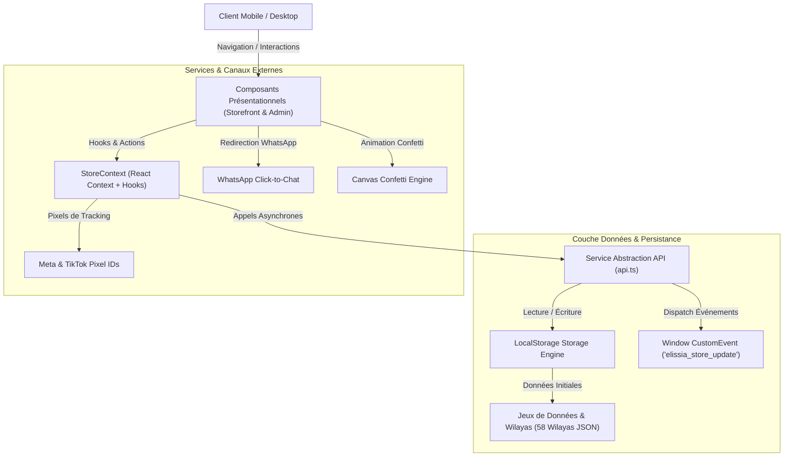
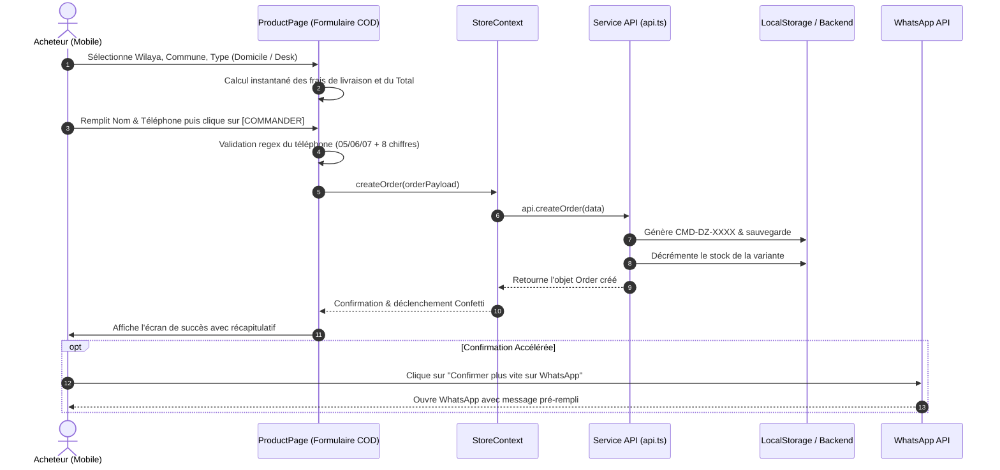
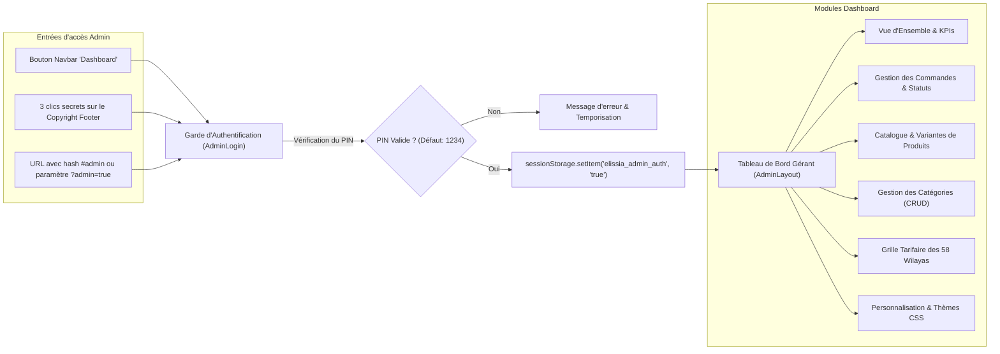
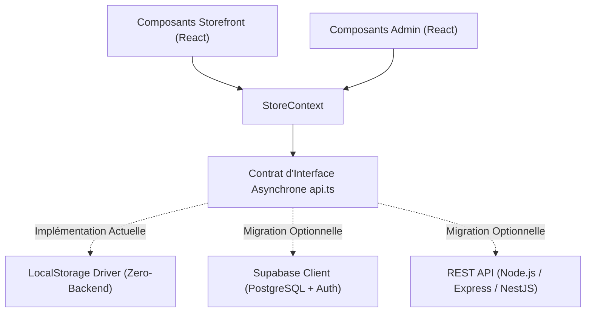

# 02 — Architecture Technique & Diagrammes

Ce document décrit l'architecture logicielle du projet **Maison Céleste**, les flux de données entre les différents composants, ainsi que les modèles de conception appliqués.

---

## 1. Architecture Globale du Système

L'application adopte une architecture **Single Page Application (SPA)** découplée basée sur React, organisée autour d'un gestionnaire d'état central (`StoreContext`) et d'un service d'accès aux données asynchrone (`api.ts`).

---

## 2. Flux de Commande COD (Cash on Delivery)

Le flux de commande a été spécialement optimisé pour le e-commerce algérien : une commande est créée directement depuis la fiche produit, entraînant le calcul instantané des frais de port et la mise à jour des stocks.

---

## 3. Architecture d'Administration et Gestion de Session

L'accès au tableau de bord gérant est protégé par un système de code PIN et une session temporaire (`sessionStorage`).

---

## 4. Modèle de Transition vers un Backend Distant (Supabase / REST)

La couche d'accès aux données dans [`src/services/api.ts`](file:///c:/Users/Mohcen/Desktop/e-commerce/src/services/api.ts) utilise exclusivement des méthodes asynchrones (`async/await`) renvoyant des promesses (`Promise<T>`).

Cette conception en **Repository Pattern** permet de basculer d'un stockage local vers une base de données distante (ex. Supabase PostgreSQL ou Firebase) en modifiant uniquement l'intérieur de `api.ts`, sans changer une seule ligne des composants React :

