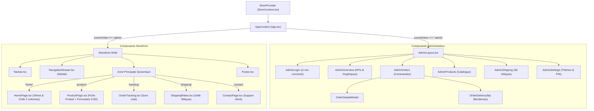

# 06 — Architecture et Conception Frontend

Ce document décrit en détail l'organisation frontend de l'application **Maison Céleste**, le cycle de rendu, le système de design et la gestion de l'état global.

---

## 1. Arbre des Composants React

Le point d'entrée [`src/App.tsx`](file:///c:/Users/Mohcen/Desktop/e-commerce/src/App.tsx) encapsule l'application dans le fournisseur d'état unifié `<StoreProvider>` et gère l'aiguillage entre l'espace public (Storefront) et l'espace privé (Admin).



---

## 2. Gestion de l'État Global (`StoreContext.tsx`)

Le contexte unifié [`src/context/StoreContext.tsx`](file:///c:/Users/Mohcen/Desktop/e-commerce/src/context/StoreContext.tsx) centralise :

1. **La navigation applicative :** `currentView` (*home*, *product*, *tracking*, *shipping*, *contact*, *admin*), `selectedProductId`, `selectedCategory` et `searchQuery`.
2. **Les données métier :** `products`, `orders`, `wilayas`, `config`, `reviews`, `categories`.
3. **Les actions métier réutilisables :** `createOrder`, `updateOrderStatus`, `createProduct`, `updateProduct`, `deleteProduct`, `addCategory`, `deleteCategory`, `updateWilaya`, `updateConfig`, `simulateDemoOrder`.
4. **L'authentification administrateur :** `isAdminLoggedIn`, `loginAdmin(pin)`, `logoutAdmin()`.
5. **Le système de notifications éphémères :** `showToast(message, type)`.

### Synchronisation Réactive Multi-Onglets

Lorsqu'une commande est passée ou qu'un produit est mis à jour dans un composant, le service [`api.ts`](file:///c:/Users/Mohcen/Desktop/e-commerce/src/services/api.ts) émet un événement DOM personnalisé :

```ts
window.dispatchEvent(new CustomEvent('elissia_store_update', { detail: { key, data } }));
```

Le `StoreContext` écoute cet événement et rafraîchit automatiquement l'état local dans tous les composants ouverts sans rechargement de page.

---

## 3. Système de Design et Thèmes Dynamiques

### Variables CSS et Thèmes Préréglés

Dans [`src/config/store.config.ts`](file:///c:/Users/Mohcen/Desktop/e-commerce/src/config/store.config.ts), 5 chartes de couleurs sont disponibles :

- **Rose Poudré (Signature)** : `#D48C98` (teinte féminine emblématique)
- **Or Rose & Soie (Prestige)** : `#C48B71`
- **Lavande Douce (Cosmétiques)** : `#9F86C0`
- **Nude & Cachemire (Minimaliste)** : `#B8977E`
- **Noir & Or (Haute Joaillerie)** : `#2B2B2B` & `#C5A059`

La fonction `applyThemeVariables(theme)` injecte dynamiquement ces couleurs à la racine `:root` du DOM :

```css
:root {
  --color-primary: #D48C98;
  --color-primary-hover: #C37985;
  --color-primary-light: #FDF4F5;
  --color-secondary: #F9F1F0;
  --color-bg-base: #FFFDFB;
  --color-accent: #E05A6D;
}
```

Tailwind CSS fait référence à ces variables dans [`tailwind.config.js`](file:///c:/Users/Mohcen/Desktop/e-commerce/tailwind.config.js), ce qui permet à l'administrateur de changer instantanément l'aspect visuel de toute la boutique sans reconstruire le code source.

---

## 4. Optimisation des Performances Frontend

1. **Lazy Loading des Images :** Toutes les balises `` utilisent l'attribut standard `loading="lazy"` pour ne charger les photos des produits qu'au moment de leur entrée dans la zone visible.
2. **Compression Client des Téléversements :** L'utilitaire [`imageCompressor.ts`](file:///c:/Users/Mohcen/Desktop/e-commerce/src/utils/imageCompressor.ts) redimensionne et compresse les images ajoutées par le gérant à une résolution maximale de 1200x1200px en JPEG 85% de qualité via un élément Canvas en mémoire, évitant la saturation du stockage du navigateur.
3. **Verrouillage Anti-Doublon :** Le formulaire de commande utilise un drapeau d'état et un `useRef` de verrouillage pour empêcher qu'un double clic rapide sur smartphone n'engendre deux commandes identiques.
4. **Bundle Ultra-Léger :** Vite sépare le code JavaScript et optimise les modules en n'exportant que les icônes et fonctions réellement appelées, produisant un bundle final de ~109 KB gzip.
