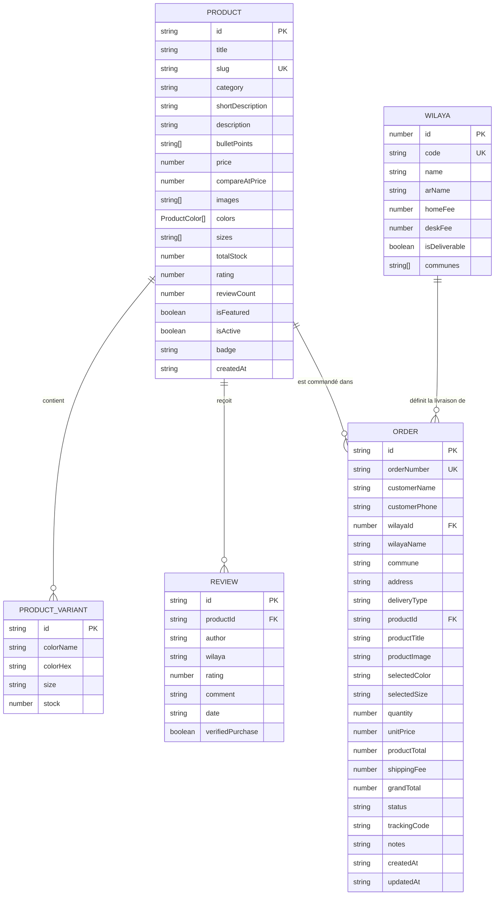

# 08 — Modèles de Données et Schémas

Ce document détaille l'intégralité des entités de données du projet **Maison Céleste**, leurs types TypeScript, leurs contraintes de validation et les relations logiques existant entre elles.

---

## 1. Schéma Entité-Relation Conceptuel (ERD)



---

## 2. Définitions TypeScript Exactes ([`src/types/index.ts`](file:///c:/Users/Mohcen/Desktop/e-commerce/src/types/index.ts))

### 2.1 Entité Produit (`Product`)
```ts
export interface ProductColor {
  name: string;      // Nom lisible (ex: "Doré Or 18k", "Noir Ébène")
  hex: string;       // Code couleur hexadécimal (ex: "#D4AF37")
  imageIndex?: number; // Index de l'image de la galerie associée
}

export interface ProductVariant {
  id: string;        // Identifiant de la variante (ex: "v1-1")
  colorName: string; // Nom de la couleur
  colorHex: string;  // Hex de la couleur
  size: string;      // Taille ou pointure (ex: "Standard", "M (38-40)")
  stock: number;     // Quantité en stock disponible pour cette variante
}

export interface Product {
  id: string;
  title: string;
  slug: string;
  category: string;
  shortDescription: string;
  description: string;
  bulletPoints?: string[];
  price: number;
  compareAtPrice: number;
  images: string[];
  colors: ProductColor[];
  sizes: string[];
  variants: ProductVariant[];
  totalStock: number;
  rating: number;
  reviewCount: number;
  isFeatured: boolean;
  isActive: boolean;
  badge?: string;
  createdAt: string;
}
```

### 2.2 Entité Commande (`Order`)
```ts
export type OrderStatus =
  | 'pending'     // En attente de confirmation téléphonique
  | 'confirmed'   // Confirmée par le client
  | 'processing'  // En cours de préparation au dépôt
  | 'shipped'     // Remise au transporteur (Yalidine, ZR Express, etc.)
  | 'delivered'   // Livrée au client et argent liquide encaissé
  | 'cancelled';  // Annulée ou refusée à la livraison

export interface Order {
  id: string;
  orderNumber: string;         // Format officiel : "CMD-DZ-XXXX"
  customerName: string;        // Nom et prénom du destinataire
  customerPhone: string;       // Téléphone mobile algérien (05/06/07)
  wilayaId: number;            // Numéro de la Wilaya (1 à 58)
  wilayaName: string;          // Nom de la Wilaya (ex: "Alger", "Oran", "Sétif")
  commune: string;             // Nom de la commune
  address: string;             // Adresse ou point de repère précis
  deliveryType: 'home' | 'desk'; // À domicile ou Bureau Stop-desk
  productId: string;           // Identifiant du produit commandé
  productTitle: string;        // Titre du produit figé au moment de la commande
  productImage: string;        // Photo du produit figée
  selectedColor: string;       // Couleur choisie
  selectedSize: string;        // Taille choisie
  quantity: number;            // Nombre d'exemplaires (min: 1)
  unitPrice: number;           // Prix unitaire en DA
  productTotal: number;        // Sous-total produits en DA
  shippingFee: number;         // Frais de livraison calculés en DA
  grandTotal: number;          // Montant total à payer en espèces (COD)
  status: OrderStatus;         // Statut dans le pipeline de traitement
  trackingCode?: string;       // Numéro de suivi transporteur externe
  notes?: string;              // Remarques internes ou créneau d'appel
  createdAt: string;           // Timestamp ISO 8601
  updatedAt: string;           // Timestamp ISO 8601
}
```

### 2.3 Entité Wilaya (`Wilaya`)
```ts
export interface Wilaya {
  id: number;                  // 1 à 58
  code: string;                // "01" à "58"
  name: string;                // Nom en alphabet latin
  arName: string;              // Nom en arabe
  homeFee: number;             // Tarif livraison à domicile en DA (ex: 500)
  deskFee: number;             // Tarif retrait bureau en DA (ex: 350)
  isDeliverable: boolean;      // Disponibilité du service
  communes: string[];          // Liste des communes de la Wilaya
}
```

---

## 3. Clés de Stockage Local ([`src/services/api.ts`](file:///c:/Users/Mohcen/Desktop/e-commerce/src/services/api.ts))

Pour garantir l'intégrité des données sans interférence entre différentes versions de l'application, les clés de `localStorage` sont versionnées :

| Clé de Stockage | Description | Données par Défaut |
| :--- | :--- | :--- |
| `celeste_products_v11` | Catalogue complet des articles et stocks | 12 articles réels dans [`mockProducts.ts`](file:///c:/Users/Mohcen/Desktop/e-commerce/src/data/mockProducts.ts) |
| `celeste_orders_v10` | Historique des commandes passées | 5 commandes de démonstration dans [`mockOrders.ts`](file:///c:/Users/Mohcen/Desktop/e-commerce/src/data/mockOrders.ts) |
| `orlea_wilayas_v7` | Grille des 58 Wilayas et tarifs personnalisés | 58 Wilayas dans [`wilayas.json`](file:///c:/Users/Mohcen/Desktop/e-commerce/src/config/wilayas.json) |
| `celeste_categories_v10` | Liste dynamique des catégories gérées | 6 catégories officielles |
| `celeste_config_v10` | Paramètres généraux, téléphone, thème CSS | Configuration dans [`store.config.ts`](file:///c:/Users/Mohcen/Desktop/e-commerce/src/config/store.config.ts) |
| `celeste_reviews_v10` | Avis et témoignages clients géolocalisés | Avis dans [`mockReviews.ts`](file:///c:/Users/Mohcen/Desktop/e-commerce/src/data/mockReviews.ts) |
